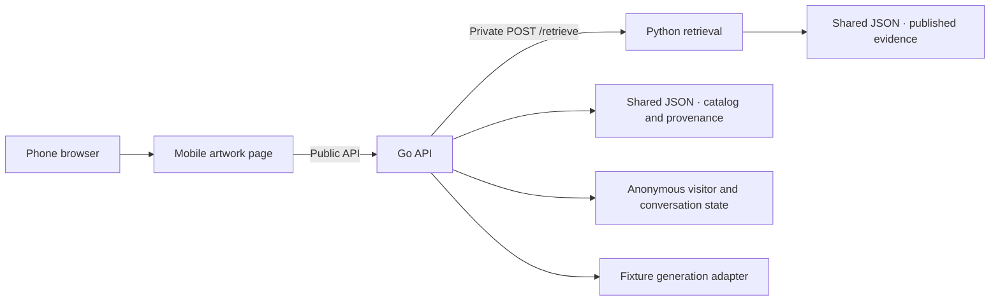

# MuseBridge Local Demo Design

This is the stage-one design for the local demo. It records the project's agreed direction and the implementation defaults selected for the first build. [plan.md](plan.md) tracks the work and review checkpoints. [api-contract.md](api-contract.md) defines the wire formats and error codes.

## Purpose

MuseBridge is a mobile museum guide. A visitor scans a QR code for an artwork and can immediately ask about the piece in front of them. The long-term goal is to support multilingual, evidence-backed conversation in the gallery.

Stage one verifies the path from a real phone to actual museum evidence. The visitor opens an artwork, submits a question, sees a clearly labeled fixture response with sources when available, and asks a follow-up within the same artwork conversation. The fixed response adapter lets the team test the application before connecting the cloud model.

### Agreed project direction

- Deliver a local demo for two Art Institute of Chicago works with phone entry points, actual museum evidence and visibly labeled fixture answers.
- Jeremiah Lim owns the mobile frontend, Jinqing Zhang owns the Go API and orchestration, and Jason Zichen He owns the Python retrieval service and source data.
- Keep one artwork per conversation. Carry relevant context forward for the scripted follow-up examples and render citations from evidence returned for the current question.

### Stage-one defaults

Use the defaults below for the first build. The team reviews the contract and shared cases together before implementation branches diverge. Later questions about cloud hosting, broader language coverage and persistent storage can be resolved after this integration.

| Area | Local demo behavior |
| --- | --- |
| Visitor interface | React and TypeScript, mobile-first artwork pages, synchronous chat submission, and a visible fixture label on each test response. |
| Artwork and release | The Bedroom uses `aic-28560`, and Woman at Her Toilette uses `aic-11723`. Each ID is also the URL slug under `/a/`. The immutable seed release is `aic-seed-v0.1`. |
| State | Go holds anonymous visitor and conversation state in memory. A conversation has a fixed 24-hour lifetime from creation and can be restored until it expires or the Go API restarts. |
| Catalog and evidence | The Go API and retrieval service read the same released JSON data. The Go API serves the artwork metadata. The retrieval service reads and indexes the evidence. |
| Retrieval | The Go API calls the retrieval service at private `POST /retrieve`. The retrieval service matches factual requests to evidence in the released JSON seed and filters by artwork before ranking. The Go API pins the release for each conversation and sends the retrieval service the prepared query, scope and result limit. |
| Generation | The Go API runs an in-process fixture adapter. It returns reviewed, scripted answers when their required evidence is present and reports known gaps or unsupported questions explicitly. |
| Languages | The visitor can request an answer in English or Simplified Chinese. Jason Zichen He tests the supported keyword coverage for each language. Source passages retain their original language. |
| Local runtime | Use a phone-reachable frontend origin with the Go API behind the same origin. The Go API reaches the retrieval service over the private service network. Compose can provide the common local startup path. |

## System boundaries

| Owner | Responsibilities | Handoff |
| --- | --- | --- |
| Jeremiah Lim | Render artwork, conversation, answer, sources and recovery states. Generate QR targets from the phone-reachable base URL. Retain the question and message ID across retryable failures. | Build against the Go API's public examples and demonstrate both entry points on a phone. |
| Jinqing Zhang | Serve the catalog, bind conversations to artworks, validate ownership, process messages in order, prepare retrieval queries, enforce deadlines, run the fixture adapter and validate citations. | Expose the public API to the frontend, call the retrieval service through its private contract, and provide integration fixtures and request traces. |
| Jason Zichen He | Review source use, maintain the seed, preserve source references, split evidence into stable chunks, and implement artwork-scoped keyword retrieval. | Publish the two artwork records, reviewed passages, supported question examples and expected evidence IDs. Expose deterministic retrieval behavior to the Go API. |

The Go API reads catalog and provenance records from the shared release and obtains ranked evidence through the retrieval service. Jason Zichen He owns the evidence format; the Python service performs all retrieval. Both services validate the same read-only release at startup. The retrieval service runs keyword retrieval entirely within Python over JSON, with no model dependency. Go keeps conversation state in memory. Cloud inference, embeddings and database migrations belong to later releases.

### Local request path

1. The visitor scans the QR code or opens the same artwork link directly. The frontend takes the slug from the URL and calls `GET /api/artworks/{slug}`.
2. The frontend shows the artwork as soon as its metadata is available. Starting the chat calls `POST /api/conversations` with the canonical `artwork_id` from the Go API. The response includes the conversation and whether it was created.
3. The frontend loads `GET /api/conversations/{conversation_id}/messages` when it restores a conversation. It shows only the history for the active artwork.
4. The frontend submits `POST /api/conversations/{conversation_id}/messages` with a client-generated UUID, a question and the requested answer language. The Go API checks ownership and uses the conversation's artwork binding.
5. The Go API reserves the logical request, prepares a query from the current question and any supported same-conversation context, then calls the retrieval service with the pinned dataset version.
6. The retrieval service filters to the requested artwork, ranks matching chunks and returns the most relevant evidence, or an empty list when no chunk matches.
7. The Go API runs the fixture adapter against the returned evidence. It resolves citation references from that evidence and commits the completed turn.
8. The frontend displays the fixture label, response and applicable sources. A follow-up uses the same conversation ID. Switching artwork resolves a different conversation.

Keep the retrieval service on the private service network during phone tests. The QR URL uses the host address or hostname reachable by the phone. A loopback URL is appropriate only for tests on the host itself. Basic artwork details stay usable while chat or retrieval is unavailable.

## Data release and retrieval

### Published seed

Jason Zichen He prepares the `aic-seed-v0.1` JSON release for the two selected artwork IDs. The release links artwork records, source records and evidence chunks. A source record identifies the institution, title, original URL, language, and documented terms for the material actually used. Jason Zichen He tracks image rights separately from metadata and text rights. A work may use a text-only page if its image is unavailable for this release. The source review records the basis for reusing a field or passage, including required attribution. [Art Institute of Chicago API documentation](https://api.artic.edu/docs/).

Each chunk has a stable ID, source reference, artwork association, original language, excerpt and source locator. A locator can point to a section or named field when no page number exists. Keep the original source URL alongside the locator so that a reviewer can find the passage. Treat source excerpts as evidence throughout the pipeline, including when the real generator is connected.

The shipped dataset is immutable. A content change that alters evidence or metadata produces a new version. The Go API pins `aic-seed-v0.1` in this local demo, persists the version on each conversation and records it on every completed turn. This keeps a saved fixture result traceable even if a later release changes the source passages.

### Evidence retrieval

`POST /retrieve` takes `artwork_id`, `query`, `dataset_version` and optional `top_k`. The retrieval service uses two results by default and accepts up to five. The response identifies the dataset version and provides an ordered list of evidence. See [api-contract.md](api-contract.md) for the required fields and validation rules.

The retrieval service validates the artwork and exact dataset version. It identifies factual requests, resolves known artwork references, and uses context to interpret dependent requests. Each request can bind only to evidence from the selected artwork that covers the requested fact. For example, the medium record can support the paint family or support type without identifying a pigment, fiber, or measurement. A compound question can keep a supported part even when another part has no evidence or refers to another work. The service ranks and deduplicates the evidence and preserves the original excerpts. An evaluation-only trace records the bindings so a correct chunk can be distinguished from a match for the wrong question.

The retrieval service returns HTTP 200 with an empty evidence list for a valid query that has no match. Before passing evidence to the fixture adapter, the Go API checks the response schema, version, artwork and chunk identity, then compares each returned record with the corresponding chunk and source in its own read-only seed. This catches incorrect provenance or altered excerpts even when a returned chunk ID is valid. An unavailable service, an expired deadline or a response that violates the retrieval contract follows the API error path.

### Follow-up handling

The Go API owns conversation binding and query preparation. In the first build, it recognizes the documented follow-up patterns for material and brushwork. A pattern rewrites to its standalone query only when a completed turn already exists in the active conversation. The current question determines the topic. Earlier turns establish that this is a follow-up within the same artwork conversation.

The retrieval service receives the prepared query and scope fields. Visitor identity and chat history stay with the Go API. Every follow-up gets fresh retrieval, and any citations come from that result. Opening another work creates or restores that artwork's own history. The stored conversation binding governs the scope of every question.

## Visitor state and request lifecycle

### Anonymous recovery

The initial conversation request obtains a random, opaque visitor cookie. The cookie is host-only, `HttpOnly` and `SameSite=Lax`. The Go API uses `Secure` under HTTPS. The documented phone-access configuration may use local LAN HTTP for the demo.

The Go API atomically creates or restores the conversation for the visitor and artwork. `POST /api/conversations` returns HTTP 200 with `conversation` and `created`. The conversation includes `conversation_id`, `artwork_id`, `dataset_version`, `created_at` and `expires_at`. The 24-hour lifetime is measured from creation.

Within that window, the same browser can refresh, switch artworks and return to its earlier history. The Go API checks the visitor cookie on both message endpoints. An unknown, expired or unowned conversation is unavailable to that caller. The frontend can resolve the artwork again and start a valid conversation. A new browser, loss of the cookie or a Go process restart can result in a new conversation with empty history.

### Submission and retry

The browser creates a `client_message_id` UUID when the visitor submits a new question. The Go API trims the question once and accepts 1 to 500 Unicode code points. `answer_language` is `en` or `zh-CN`. The logical request key combines the conversation ID and client message ID. The normalized question and requested language are part of the identity of that request.

The Go API reserves one in-flight request per conversation, then calls its dependencies within the attempt deadline. A replay with the same key and normalized payload returns the original completed turn. A reused key with changed input or a conflicting in-flight request returns HTTP 409. The frontend keeps the original question and UUID for a retry, including after losing the HTTP response. Retry works independently of whether the browser received the first result.

Successful completion appends one turn with a server-assigned `sequence`. On a technical failure, the Go API retains the attempt as a failed pending request so the frontend can retry with the same key. Accepting a different key supersedes the prior failed key. History returns the conversation, its ordered completed turns and the current `pending_request`. After a reload, the frontend reconciles the pending request with history and recovers its original question and UUID when a retry is available. The frontend matches each response to the active conversation before rendering it, especially when a visitor switches artworks while an earlier request is pending.

| Budget | Value | Purpose |
| --- | --- | --- |
| Retrieval service retrieval | 3 seconds | Bound a call to the private service. |
| Fixture adapter | 2 seconds | Keep a separate generation boundary with a predictable deadline. |
| Go API question attempt | 8 seconds | Bound the accepted attempt from reservation through dependency calls and response assembly. |
| Browser wait | 12 seconds | Give the Go API time to return a structured result before the client gives up. |

The Go API reports an unavailable dependency as HTTP 503, an expired dependency or request deadline as HTTP 504, and an invalid downstream response as HTTP 502. Examples of contract violations include a malformed retrieval body, a mismatched dataset version or evidence assigned to the wrong artwork. The frontend keeps the question visible and uses the response's retry guidance. Retry and history recovery leave at most one completed turn per logical request.

## Fixture answers and citations

The generator boundary takes the question, requested answer language, prepared same-artwork context and validated current evidence. It returns the answer and the IDs it wants to cite. In stage one, the Go API runs a deterministic fixture implementation through that boundary. Each fixture is tied to an artwork, a reviewed question or supported follow-up, an answer language and the evidence IDs required for its text.

| Completed status | Behavior |
| --- | --- |
| `answered` | Use the reviewed fixture when every required evidence ID is in the current result. Resolve citation text and links from those records. |
| `insufficient` | Explain the coverage gap when a valid retrieval is empty, the question is a reviewed source gap, or an applicable fixture's required evidence is missing. A reviewed gap can still return keyword hits. |
| `unsupported_question` | Explain that this question is outside the scripted coverage when there is a retrieval match but no applicable answer fixture. A match alone provides no basis for a factual answer. |

Completed turns expose the answer status, `mode: "fixture"`, text and a citation list. The UI visibly labels all fixture outcomes. The Go API builds citations from validated chunks in the same request, artwork and dataset version. Insufficient and unsupported responses display a coverage message and an empty citation list. Service failures use the API error path, separate from the three completed answer statuses.

## Local integration and diagnostics

Start the frontend, Go API and retrieval service from the same checked-out revision and mount the same seed release for both services that consume it. The retrieval service validates its evidence before serving retrieval. The Go API validates its catalog and provenance records at startup. The frontend loads artwork metadata through the Go API so QR routing, displayed artwork IDs and conversation creation use the same data.

The first build can proceed with the defaults in this design and the API contract. Before a phone walkthrough, set the actual LAN origin in the web, QR and Go configuration and verify that the phone can reach it. Local startup instructions list that origin, the Go API's internal retrieval URL, the seed path and the network steps for reproducing the demo.

For a question attempt, the Go API should record a request ID, the artwork ID, the dataset version, retrieval and fixture durations, the result category and the returned evidence IDs. These fields are enough to trace an integration example without putting visitor text or cookie values in routine logs. A retry can produce a new attempt trace for the same logical message. Replaying a completed turn should log the replay and skip both downstream calls.

Use the real retrieval service for the final walkthrough. The Go API can use a contract-shaped retrieval service stub while the frontend screens are being built, and the team can use a deliberately failing or delayed stub to make the error paths reproducible. Keep the fixture label visible throughout the live walkthrough so the audience can tell which parts of the flow it is testing.

## What proves the demo works

- **Phone flow.** Each QR opens the correct artwork page on a phone. The visitor can reach chat from either entry point and can still read the artwork information during an induced chat failure.
- **Evidence trace.** For a reviewed question on each artwork, compare the displayed citation with the actual the retrieval service response, source URL, locator and pinned version. Test an English question and a Simplified Chinese question. Include a Simplified Chinese question that retrieves an English source passage.
- **Scope isolation.** Ask similar questions in the two artwork conversations, switch back to the first, and submit a supported follow-up. Check that the Go API derives the artwork from the conversation, the retrieval service returns only that artwork's evidence, and the frontend shows the matching history even when responses arrive after a switch.
- **Three answer outcomes.** Use real retrieval for an answered fixture, an empty retrieval and an off-script query with hits. Use a controlled retrieval service stub to supply a related passage for a reviewed source gap and check that the Go API still returns `insufficient`. Check the fixture label and the distinct fallback messages.
- **Failure and recovery.** Induce an unavailable dependency, a deadline and an invalid downstream response. Verify that the original question and UUID survive retry, a replay after a lost success response reuses the original turn, and competing requests preserve at most one completed turn per logical request.
- **Repeatable startup.** A teammate starts the project with the same seed, follows the phone instructions and runs the same checks without credentials for a model or a database.

The stage verifies routing, retrieval, evidence provenance, fixture output and the supported follow-up flow. Accuracy, open-ended follow-up understanding and real multilingual generation require separate evaluation when the cloud adapter is connected. [Delivery plan and acceptance checklist](plan.md).

## After the local demo

The next core release connects a real model running on cloud GPU infrastructure through the Go API's generator boundary. It expands the reviewed collection toward 6–10 artworks and evaluates retrieval with broader bilingual queries. The team can compare keyword retrieval with multilingual embeddings, and consider PostgreSQL and pgvector when persistent sessions or a larger index justify the work. The course demo should link a phone-originated request to model-service records and actual GPU execution evidence.

Evaluate the visitor workflow and answer quality separately. Compare time to the first useful answer and task completion in the product experience. Use the same questions and comparable evidence for answer-quality comparisons with general assistants, and assess source support, multilingual answers, follow-ups and evidence gaps. Comparison with a museum guide depends on access to a suitable product and equivalent tasks.

Search, cross-artwork comparison, shared conversations and staff publishing are later product choices. Museum interviews can test who would use the guide, who could buy it, and what evidence would justify a pilot. Source and pilot permissions, willingness to pay, and course deliverables remain inputs to the later roadmap.

### Decisions for later stages

These decisions have owners and review points. The local implementation uses the defaults above while the team gathers the information needed for later stages.

| Decision | Owner | When needed |
| --- | --- | --- |
| GPU provider, inference model and budget | Jinqing Zhang, with the team reviewing | Before stage two. Confirm GPU access, the cost limit and the evidence the course accepts for a real inference request. |
| Persistent session storage and retrieval index | Jinqing Zhang and Jason Zichen He | After stage one. Use the larger corpus and measured retrieval needs to decide when a database or vector index is warranted. |
| Course rubric, submission deadlines and interview or recording requirements | Jinqing Zhang coordinates with Jeremiah Lim and Jason Zichen He | Confirm early, before scheduling recordings, recruiting interviewees or committing to a cloud deployment. |
| Evaluation participants, language reviewers and comparison access | Jeremiah Lim and Jason Zichen He, with Jinqing Zhang preparing traces | Confirm early, before recruiting or finalizing tasks. Check participant access and whether reviewers can assess both languages. |
