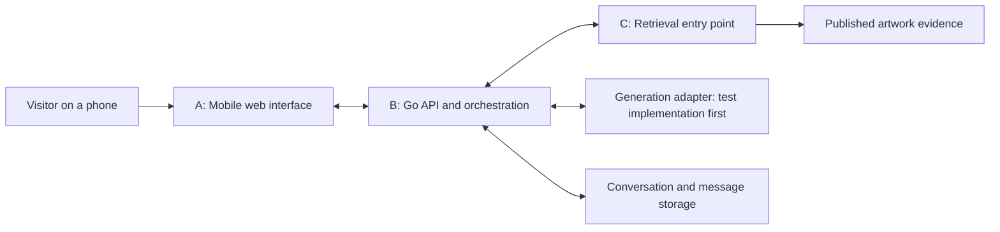

# MuseBridge: Local Demo Design

Status: Draft for review by A, B, and C.

This document explains the current stage and how the three contributors work together. It distinguishes existing project decisions from proposals that still need agreement. It does not describe completed implementation or a finalized API contract.

## 1. Stage Goal and Scope

Build a local demonstration for two artworks:

**Scan a QR code -> open the artwork page -> ask a question -> retrieve real museum evidence -> display a test answer and its sources -> ask a follow-up question.**

The purpose of this stage is to verify the complete application flow and the boundaries between the frontend, backend, and retrieval module.

| Included in this stage | Expected behavior |
| --- | --- |
| Two artwork pages | Each QR code opens the correct page with basic artwork information and a question entry point. |
| Artwork-specific conversations | Each conversation belongs to one artwork. The backend stores messages and supplies relevant history to downstream components. |
| Real museum material and retrieval | Questions retrieve actual source passages associated with the current artwork. |
| Test generation | A replaceable generation adapter returns clearly labeled test responses until real generation is connected. |
| Evidence display | The frontend displays source information and links that resolve to the retrieved evidence. |
| Failure handling | The application preserves user input and supports agreed behavior for unavailable services, timeouts, and retries. |
| Reproducible local setup | Another team member can follow the startup instructions and run the same flow. Phone access must be verified separately from computer access. |

Real cloud GPU generation and expansion to approximately 6-10 artworks belong to the later core release. Search, cross-artwork comparison, shared conversations, and a museum administration interface are outside this local demo stage.

Passing this stage does not establish answer accuracy or semantic understanding of follow-up questions. Fixed test responses cannot validate those capabilities.

## 2. Visitor Flow

1. **Open an artwork.** The visitor scans a QR code or follows an artwork link, such as `/a/{artworkSlug}`. The page shows the artwork title, artist, and available introductory information.
2. **Start a conversation.** The frontend obtains a conversation bound to that artwork. The visitor does not need to register. Anonymous identity and conversation recovery rules remain open decisions.
3. **Ask a question.** The frontend sends the question to the Go backend. The backend checks the conversation and determines the artwork from the stored conversation binding.
4. **Retrieve evidence.** The backend obtains relevant conversation history and calls C's retrieval entry point. Retrieval prioritizes the current artwork and may include relevant exhibition background.
5. **Prepare the response.** The backend passes the question, necessary history, requested answer language, and retrieved evidence to the generation adapter. The local demo uses a test implementation.
6. **Show the answer and sources.** The backend validates referenced evidence identifiers and resolves source details from trusted retrieval data. The frontend displays the test label, answer, and sources.
7. **Continue the conversation.** Follow-up questions use the same artwork conversation. Messages from other artwork conversations are not included automatically.
8. **Handle incomplete results or failures.** The interface distinguishes insufficient evidence from technical failures. Test-only outcomes must be identifiable as simulated. Retry behavior must avoid duplicate questions and answers.

Switching to another artwork uses a separate conversation. Preserving the previous conversation and restoring it on return or refresh is the current proposal, pending agreement on identity, expiry, and recovery behavior.

Basic artwork information should remain readable when the question-answering service is unavailable.

## 3. Modules and Responsibilities

The diagram shows logical responsibilities. Retrieval transport, database schema ownership, and storage access boundaries still need agreement.

| Owner | Responsibilities | Handoff to other contributors |
| --- | --- | --- |
| A: Frontend | Mobile artwork pages, QR-code routes, chat interface, source display, waiting and error states, and retry interaction. | Calls B's public APIs; displays the agreed response shapes; provides phone-based walkthroughs. |
| B: Go backend and integration | Artwork APIs, conversation ownership and validity, ordered message history, retrieval orchestration, generation adapter, citation validation, request tracing, timeouts, and duplicate-submission handling. | Provides public APIs to A; calls C's retrieval entry point; assembles and stores the response returned to A. |
| C: Artwork data and retrieval | Selects the two artworks, checks source usage conditions, prepares and imports source material, chunks and embeds text, and verifies retrieval quality. | Supplies stable artwork metadata, evidence identifiers, source metadata, a repeatable import process, and a retrieval entry point B can call. |

B and C jointly define how artwork metadata becomes available to the Go API, who maintains shared migrations, and which component performs each retrieval operation. Their implementations should follow one agreed retrieval path.

The initial technology direction is React and TypeScript for A, Go for B, Python for C's data processing and retrieval work, PostgreSQL with pgvector for storage, and Docker Compose for local integration. Detailed service boundaries and model choices remain subject to agreement and validation.

## 4. How the Team Integrates

Before implementing across module boundaries, agree on shared examples and document the public API and internal retrieval contract in `docs/api-contract.md`.

1. **Choose common inputs.** C prepares two artwork records and a small question set with expected evidence, source links, and known coverage gaps. A, B, and C use the same artwork and evidence identifiers.
2. **Connect A to B.** B initially exposes the agreed public API using sample artwork and retrieval data plus test generation. A builds the complete page and conversation flow against those responses.
3. **Connect B to C.** B replaces sample retrieval with C's real retrieval entry point. The team checks artwork filtering, evidence identity, source display, history transfer, and retrieval failure behavior.
4. **Run the local demo together.** Verify both QR codes on phones and exercise follow-ups, insufficient-evidence scenarios, and timeout retries. Label any simulated behavior.
5. **Connect real generation later.** Replace the test generation implementation through the same adapter boundary, then separately evaluate factual accuracy, citation support, and follow-up understanding.

A shared example should trace one question from the frontend request through retrieval evidence to the displayed response. Cross-module behavior changes require updates to the contract and coordination with the affected contributors.

## 5. Confirmed Project Decisions

These record the existing project direction. This draft still requires team review.

- The product is a museum artwork guide accessed through QR codes and mobile web pages.
- A owns the frontend, B owns the Go application backend and integration, and C owns artwork material and retrieval.
- The local demo starts with two artworks, real source material, real retrieval, and explicitly labeled test generation.
- Each conversation is bound to one artwork. Changing the frontend page must not reassign an existing conversation to another artwork.
- The backend stores conversation history and makes relevant history available to retrieval and generation.
- The initial public API surface covers artwork lookup, conversation creation, message history, and question submission. Detailed behavior is not yet frozen.
- Initial question submission uses synchronous JSON responses, with questions handled in order within a conversation.
- Displayed citations must resolve to evidence retrieved for that question. The backend resolves source links from trusted evidence metadata.
- Insufficient evidence is a valid question-answering outcome and must be distinguished from a service error. A retrieval match alone does not prove that the question is answerable.

## 6. Open Decisions for Team Review

| Question | Current proposal or point to resolve | Contributors |
| --- | --- | --- |
| Which two artworks and sources? | Agree on stable identifiers, slugs, usable source material, image permissions, and shared examples. | C leads; A and B review. |
| How are conversations recovered? | Use an anonymous cookie and create or restore a valid conversation for the visitor and artwork. Confirm switching, return, refresh, expiry, and history-retention behavior. | B leads; A reviews. |
| What is the public API contract? | Define paths, field names, required values, message ordering, answer states, citation structure, and errors for the four public entry points. | A and B; C reviews evidence fields. |
| How do retries work? | Identify a logical question by conversation ID and client message ID. Agree on repeated inputs, conflicting inputs, in-progress requests, and retryable failures. | B leads; A reviews. |
| How does B call C? | Internal HTTP is a proposed option. Confirm request and evidence formats, timeouts, and the distinction between empty results and retrieval failure. | B and C. |
| Who handles follow-up references? | B supplies history. Decide whether B rewrites the retrieval query or C receives history and resolves references. Validate semantics separately from history transfer. | B and C. |
| Who owns shared data definitions? | Assign ownership of artwork tables, knowledge tables, migrations, seed imports, and the metadata read by B. | B and C. |
| How are language and evidence sufficiency handled? | Confirm English and Simplified Chinese coverage. Keep question, source, and answer languages distinct. Assign responsibility for full, partial, and insufficient-evidence outcomes. | A, B, and C. |
| How are data versions used? | Define a consistent evidence release for each question and decide whether a conversation stays on one release. | B and C. |
| How is the system run locally? | Agree on startup commands, ports, configuration, sample data, and the phone-access procedure. Keep credentials on the backend. | B coordinates; A and C supply module setup. |

## 7. Stage Completion Checks

- Both QR codes open the correct artwork page on a phone.
- A submitted question reaches C's real retrieval implementation, and displayed sources trace to the returned evidence.
- Follow-up messages stay in the correct artwork conversation, with relevant history passed downstream.
- Insufficient-evidence and technical-failure states can be demonstrated; simulated outcomes are labeled.
- A timeout and retry leave one logical question and at most one completed answer in the conversation.
- If conversation recovery is included in the agreed scope, switching artworks, returning, and refreshing restore the correct history without mixing conversations.
- Another team member can reproduce the local flow from the startup instructions.

These checks verify the local integration. Real generation quality and complete multi-turn understanding require additional evaluation after a real model is connected.
