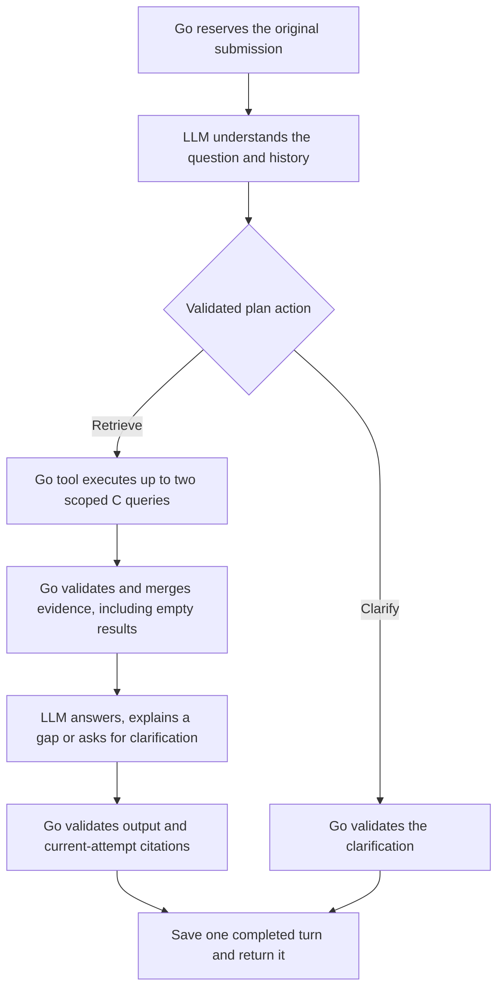

# Local LLM integration contract proposal

Status: **Draft for team review. Not implemented or approved.**

Proposed contract revision: `local-llm-v0.2`. Draft date: November 12, 2026.

The [current API contract](api-contract.md), revision `local-demo-v0.1`, remains the implemented baseline. This proposal defines the behavior to agree before replacing fixture-only generation. Its new enum values, deadlines and validation rules must not be treated as available until the affected implementations and shared examples are updated together.

## 1. Scope and ownership

The proposed milestone connects the existing browser, Go API and Python retriever to a locally hosted Qwen model through Ollama. In LLM mode, question understanding happens before retrieval: the generation workflow asks the model to interpret the visitor's wording, obtains a bounded retrieval plan, executes that plan through C, and then asks the model to answer from the returned evidence. This ordering is intended to handle misspellings, imprecise wording and contextual references without treating the raw question as the only search query. It does not guarantee that every interpretation is correct.

Keep fixture mode available for deterministic regression checks. This local GPU integration is an intermediate step; it does not close the hosted/cloud acceptance item in the [implementation plan](plan.md#stage-2-cloud-gpu-demonstration).

| Owner | Responsibility in this proposal |
| --- | --- |
| Jeremiah Lim | Browser response parsing, answer-source labels, waiting and recovery behavior, and physical phone acceptance |
| Jinqing Zhang | Go workflow interfaces, model-assisted query planning, controlled retrieval execution, generation clients, validation, request state and deployment configuration |
| Jason Zichen He | Authoritative source content and releases, retrieval behavior, citation-support review and bilingual evidence expectations |

The first integration keeps two artworks, one artwork per conversation, the existing in-memory lifetime and ownership rules, synchronous JSON responses, and the existing submission/replay semantics. Model-assisted question interpretation and query preparation are included in this revision. It does not add streaming, vector search, persistent storage, cross-artwork conversations, a larger corpus or an open-ended agent loop.

## 2. Proposed decisions

Every item below is a recommendation awaiting the review recorded in section 12.

| Area | Recommendation |
| --- | --- |
| Evidence authority | C owns evidence content and source associations. Go checks the interaction contract rather than comparing every returned passage with a complete local copy. |
| Artwork metadata | Go keeps the minimal catalog needed for artwork routes and conversation binding. It does not need a second complete evidence store in LLM mode. |
| Generation boundary | Start the Go-owned generation workflow with the original question and context, before any C lookup. Inject a controlled retrieval tool into that workflow. |
| Understanding output | The model returns either a retrieval plan with at most two queries or a clarification question. Go validates the plan before executing it. |
| Final model output | Use `status`, `text` and `citation_chunk_ids`. The model cannot set public answer mode or create source objects. |
| Empty retrieval | Return the empty result to the final model stage. Allow an evidence-gap explanation or clarification, never a factual answer from model memory. |
| Public answer source | Use `fixture` and `llm`; remove the earlier proposed empty-result `system` path. |
| Clarification | Add `clarification_needed` as a completed, citation-free LLM outcome. The user's next reply is a new submission in the same conversation. |
| Partial questions | Do not add a partial-answer status in this revision. If essential requested information lacks evidence, return `insufficient` and explain the gap without adding uncited factual answers. |
| Failure behavior | Keep technical failures separate from insufficient evidence. Do not silently substitute fixture answers after model failure. |
| Execution | Select the backend mode at startup; configure the browser and proxies for the same deployment profile. |

The recommended implementation is an explicit two-stage model protocol: understand/plan, then answer from tool results. It does not require native provider tool calling. Go executes the lookup requested by the validated plan; the model does not directly access a database, run SQL, call arbitrary URLs or choose another artwork. Planning may finish with clarification before any lookup. There are at most two model calls and two C calls per accepted attempt, with no unbounded search or rewrite loop.

## 3. Changes at each boundary



The first C call in LLM mode occurs only after a valid retrieval plan. A technical failure at any stage aborts completion and follows the existing pending-request recovery path.

| Boundary | Unchanged | Proposed change |
| --- | --- | --- |
| Browser to Go | Public routes, request fields, cookies, origins, UUID identity, conversation binding and `Turn` envelope | Accept `mode: llm` and `status: clarification_needed`; coordinate waiting and recovery windows |
| Go to C | Single-query `POST /retrieve`, request/response fields, request ID behavior, version pinning and `top_k: 2` per call | Execute at most two validated model-planned queries; remove the complete local evidence copy dependency and retain transport, shape and scope checks |
| Go to generation workflow | Original question, answer language and limited same-conversation history | Move types out of `fixture`; invoke model understanding before the injected retrieval tool |
| Model planning to Go | Server-owned artwork and release | Add a structured interpretation and retrieve-or-clarify action; model output cannot change scope |
| Final generator to Go | Text and citation IDs | Allow answered, insufficient or clarification outcomes; validate against the accepted evidence collected during this attempt |
| Go to browser | HTTP 200 for completed outcomes; error envelope for technical failures | Set source mode from the actual path and construct citations from the accepted current retrieval result |

No new browser or retrieval endpoint is required by this proposal. Existing public requests still use:

```text
GET  /api/artworks/{slug}
POST /api/conversations
GET  /api/conversations/{conversation_id}/messages
POST /api/conversations/{conversation_id}/messages
```

## 4. Evidence authority and validation

### 4.1 C's guarantees

C owns the correctness of published excerpts, chunk identity, artwork/source associations, locator, language, attribution and license metadata. A content or metadata change requires a new dataset version. Retrieval must return only evidence within the requested artwork and release, using the existing response fields.

The public museum record may contain more material than the released dataset. C's empty result means no matching evidence was returned from that release; it does not claim that the museum has no additional information.

### 4.2 Go's runtime checks

Go continues to validate:

- HTTP response status, JSON encoding and integrity, expected request ID, body size and deadline.
- Required fields, types and agreed field limits, while ignoring compatible additive response metadata.
- Dataset version against the request and conversation.
- Every evidence record's artwork ID against the conversation.
- Nonempty unique chunk IDs within each C response and the requested per-call result limit.
- Complete provenance fields and source URL syntax under the agreed schema.

Go must reject a response with a foreign artwork record rather than quietly drop it and continue. Source association correctness remains C's responsibility; Go must not infer a complete source registry from identifier spelling.

For multiple planned queries, send each as an ordinary `POST /retrieve`; do not add a `queries` array to C's existing request body. Go supplies the conversation's artwork/version and `top_k: 2` for every call. Forward the attempt request ID and record the retrieval-call index in Go diagnostics.

The final evidence snapshot is the deduplicated union of the accepted responses, at most four unique records with the proposed limits. Merge in plan-query order and then C result order, retaining the first position of an identical repeated record; completion timing must not change this order. Repeating an identical chunk across separate queries is normal. If the same `(dataset_version, chunk_id)` has conflicting content or provenance across responses, fail with `retrieval_invalid_response` instead of choosing one silently. A failure in any executed lookup remains a technical failure; do not present an incomplete search plan as a fully completed one.

For the LLM path, Go no longer requires each chunk ID to exist in a local global list or compares returned excerpts and source fields byte-for-byte with a seed snapshot. Existing seed-content checks can remain in release validation, offline integration checks and fixture-specific regression support.

Go may keep a small artwork catalog for routing and availability during retrieval outages. As a transition, it can extract artwork metadata and release identity from the existing file, retaining no full chunk/source collections for LLM validation. A dedicated C catalog endpoint is optional future work, not a requirement for this milestone.

## 5. Question understanding, retrieval and generation contract

### 5.1 Workflow input owned by Go

| Field | Meaning |
| --- | --- |
| `artwork_id` | Derived from the conversation, never selected by the model |
| `dataset_version` | The conversation's fixed release |
| `question` | The original submitted question, preserved for storage, display and idempotency |
| `answer_language` | Exactly `en` or `zh-CN`; authoritative even when question or sources use another language |
| `recent_turns` | At most three completed turns from this conversation, with an additional total-length budget |
| `artwork_metadata` | The current artwork's basic catalog context, not a full evidence store |

There is no pre-retrieved evidence input at workflow entry. The workflow contains a model planner, a Go-executed retrieval tool and a final answer generator. They may use the same Ollama client/model, but have separate schemas, prompts, deadlines and diagnostics. The outer chat service continues to own request reservation and completion.

### 5.2 Stage one: understand and plan

The first model call receives the original question, selected answer language, current artwork context and bounded history. Ask it to preserve the requested facts while correcting clear misspellings, making references explicit and preparing search wording compatible with C. It may choose English search wording for English sources, independently of the requested answer language.

The model returns exactly these four fields:

```json
{
  "action": "retrieve",
  "interpreted_question": "What material is the current artwork made of?",
  "queries": ["What material is this artwork made of?"],
  "clarification_question": ""
}
```

For an ambiguous reference it can instead return:

```json
{
  "action": "clarify",
  "interpreted_question": "The visitor asks about an unspecified detail in the current artwork.",
  "queries": [],
  "clarification_question": "Which detail in the painting do you mean?"
}
```

| Invariant | Rule |
| --- | --- |
| Action | Exactly `retrieve` or `clarify`; there is no factual-answer action before retrieval. |
| Interpretation | Nonempty valid text, at most 1,000 Unicode code points; it is the model's interpretation, not a replacement for the stored question. |
| Retrieve action | One or two distinct, nonempty queries, each within C's existing 1,000-code-point limit; `clarification_question` must be empty. |
| Clarify action | Empty query array and a nonempty clarification question of at most 2,000 code points in `answer_language`. |
| Scope | No model-controlled artwork ID, release, `top_k`, endpoint, URL, SQL or executable tool name. Go fills the retrieval arguments. |
| Integrity | No extra/missing fields, null required fields, duplicate properties or incomplete/truncated output. |

Correct spelling only when the intended request is reasonably clear. Do not silently turn a request for an artist's reason into a request for the material, change an uncertain name into a known fact, or reinterpret a named other artwork as the current one. If several plausible meanings remain, ask for clarification. Go can enforce shape and scope but cannot mechanically prove that every rewrite preserves intent; this needs separate evaluation.

An `action: clarify` result becomes a completed `clarification_needed` turn with `mode: llm` and no citations. It does not call C or a second model stage. The visitor's response uses a new message ID in the same conversation, and that history helps the next planning call.

### 5.3 Stage two: execute the retrieval tool

Go validates the plan and executes every accepted query through the existing C endpoint. The workflow may make at most two C calls per attempt, each with `top_k: 2`, under the fixed conversation scope. The two explicit planned queries are not an automatic transport retry.

The model has no direct database, filesystem or network access. The injected tool is the only lookup mechanism. Collect and validate the responses as specified in section 4, then create a detached current-evidence snapshot. Do not start another plan/search loop after the allowed calls have been used.

### 5.4 Stage three: answer from tool results

The final model call receives the original question, its interpreted form, executed queries, requested language, bounded history and accepted evidence. The original wording remains available so answering does not depend only on a potentially mistaken interpretation. Recent answers provide context but do not become new museum evidence.

Empty evidence still reaches this stage. The model may explain that the attempted lookup found no supporting evidence or ask a focused clarification question. It must not answer factual questions from its own memory. A nonempty result also does not automatically establish answerability.

Require exactly these output fields:

```json
{
  "status": "answered",
  "text": "The museum records this work as oil on canvas.",
  "citation_chunk_ids": ["aic-28560-medium"]
}
```

| Invariant | Rule |
| --- | --- |
| Status | Exactly `answered`, `insufficient` or `clarification_needed`. |
| Text | Nonempty valid UTF-8, at most 2,000 Unicode code points, in the requested language. |
| Citations | Unique IDs from the accepted evidence collected during this attempt, no more than the evidence count. |
| `answered` | At least one valid supporting citation; impossible when the evidence snapshot is empty. |
| `insufficient` | Empty citations and a brief description of what the attempted search/evidence did not establish. |
| `clarification_needed` | Empty citations and a focused question; no unsupported factual explanation. |
| Completion and integrity | Reject truncation, duplicate keys, null required fields, unexpected fields, Markdown wrappers or trailing content. |

The model must not return source objects, URLs, public mode, visitor identity or replacement scope. Use JSON Schema for both model stages and validate independently in Go. Resolve citation IDs from this attempt's evidence union, not a local full knowledge base or previous turns.

Language checks and citation membership are not proof of semantic fidelity, factual support or language quality. Review these separately. Do not silently truncate source passages or instructions to fit the model; trim history first. Character limits are not exact token budgets. Final input limits and any context-budget error must be agreed before implementation acceptance.

### 5.5 Fixture compatibility

Fixture mode keeps its existing ordering, documented follow-up rules, known question coverage, bilingual copy and exact-answer checks. `unsupported_question` remains fixture-only.

LLM mode instead uses model understanding and planning. It must not be constrained to the fixture question whitelist or rule-based follow-up patterns. It does not use fixture known-gap selectors or exact-text validation, and must not fall back silently to raw-question retrieval when planning fails.

## 6. Completed answer states and source labels

The existing `Answer` shape remains `status`, `mode`, `text` and `citations`. Go sets `mode`; it is not copied from model output.

| Configured strategy | Condition | Public status | Public mode | Citations |
| --- | --- | --- | --- | --- |
| `fixture` | Existing reviewed fixture behavior | Existing three statuses | `fixture` | Existing fixture rules |
| `llm` | Planner requests clarification before lookup | `clarification_needed` | `llm` | Empty; no C call or final model call |
| `llm` | Valid model answer supported by current evidence | `answered` | `llm` | Accepted current evidence |
| `llm` | Final model explains an empty or inadequate evidence result | `insufficient` | `llm` | Empty |
| `llm` | Final model needs a more precise question | `clarification_needed` | `llm` | Empty |
| `llm` | Planning, retrieval or final generation fails technically | No completed answer | No success mode | Error envelope; no completed turn |

The public source modes in this draft are `fixture` and `llm`. The frontend shows fixture responses as fixed test responses and LLM responses as model-generated. Render `clarification_needed` as an assistant question that the visitor can answer, not a technical error. Controls and labels stay in English; generated text follows `answer_language`. Historical turns keep their recorded mode and status.

A clarification is a completed turn, so it is saved and replayed normally. Its subsequent visitor reply is a new logical submission; it does not retry or overwrite the clarification turn. No additional browser endpoint is needed.

## 7. Illustrative wire examples

These are proposed response examples, not claims that the current server returns them. Examples are independent traces. Existing `Turn` fields and the error envelope are inherited from `local-demo-v0.1`.

### 7.1 Answered request through the real model

Submit to `POST /api/conversations/11111111-1111-4111-8111-111111111111/messages`, using the owning visitor cookie and configured Origin:

```json
{
  "client_message_id": "33333333-3333-4333-8333-333333333333",
  "question": "What matrial is this paining made of?",
  "answer_language": "en"
}
```

The first model call can return the normalized retrieval plan in section 5.2. Go then sends its query to C under the conversation's scope. Assume C returns the current artwork's medium evidence; the second model call can produce HTTP 200 after validation:

```json
{
  "turn": {
    "turn_id": "22222222-2222-4222-8222-222222222222",
    "sequence": 1,
    "client_message_id": "33333333-3333-4333-8333-333333333333",
    "question": "What matrial is this paining made of?",
    "answer_language": "en",
    "dataset_version": "aic-seed-v0.1",
    "created_at": "2026-11-12T18:00:00Z",
    "answer": {
      "status": "answered",
      "mode": "llm",
      "text": "The museum records this work as oil on canvas.",
      "citations": [
        {
          "chunk_id": "aic-28560-medium",
          "artwork_id": "aic-28560",
          "source_id": "aic-api-28560",
          "source_title": "The Bedroom — Art Institute of Chicago API record",
          "source_url": "https://api.artic.edu/api/v1/artworks/28560",
          "source_language": "en",
          "source_locator": "data.medium_display",
          "excerpt": "Oil on canvas",
          "license": "CC0-1.0",
          "license_url": "https://creativecommons.org/publicdomain/zero/1.0/",
          "attribution": "Art Institute of Chicago",
          "normalization": "none"
        }
      ]
    }
  }
}
```

The stored question remains misspelled exactly as submitted under the existing trimming rules. Do not replace it with the interpretation or search query. This is an illustrative successful interpretation, not a promise that all typos are corrected. Acceptance checks both interpretation fidelity and evidence-supported answering. Fixture mode may still classify this wording as off-script.

### 7.2 Successful empty retrieval

If all executed queries successfully return empty evidence, pass that tool result to the final model. A valid evidence-gap response appears at `turn.answer` inside an otherwise complete HTTP 200 `Turn`:

```json
{
  "status": "insufficient",
  "mode": "llm",
  "text": "The attempted search did not return evidence for the requested detail.",
  "citations": []
}
```

In this example `status: insufficient` reports the search outcome rather than requesting clarification. If the response needs the visitor to disambiguate the request, use `clarification_needed` as below. There is a planning call and a final model call even though no evidence was found. Do not claim that the museum has no relevant material or let an empty result bypass grounding requirements.

### 7.3 Clarification before retrieval

For an unclear reference, a valid planner `action: clarify` becomes this `Answer` in a completed HTTP 200 `Turn`:

```json
{
  "status": "clarification_needed",
  "mode": "llm",
  "text": "Which detail in the painting do you mean?",
  "citations": []
}
```

No C call is made, no factual answer is invented, and the visitor can answer in the same conversation with a new submission ID. The clarification must follow the selected answer language.

### 7.4 Related evidence that cannot fully answer

For example, a question asks for both the medium and the hours spent painting. The medium passage does not establish duration. If the model returns a valid gap explanation, HTTP 200 contains an `Answer` such as:

```json
{
  "status": "insufficient",
  "mode": "llm",
  "text": "The retrieved material does not state how many hours this version took to paint.",
  "citations": []
}
```

Do not display an uncited factual partial answer under this fallback. Adding partial-answer behavior requires a separate decision and examples.

### 7.5 Model unavailable

HTTP 503, with no completed turn:

```json
{
  "request_id": "req-llm-example-001",
  "error": {
    "code": "generation_unavailable",
    "message": "The answer service is temporarily unavailable.",
    "retryable": true
  }
}
```

Preserve the original submission payload and ID for a user-initiated retry. Do not replace this error with `insufficient` or fixture text.

### 7.6 Invalid model citation or plan

If the model cites an ID absent from the current evidence, return HTTP 502, with no completed turn:

```json
{
  "request_id": "req-llm-example-002",
  "error": {
    "code": "generation_invalid_response",
    "message": "The answer service returned an invalid response.",
    "retryable": false
  }
}
```

Invalid planner actions, scope overrides or over-budget query plans also use `502 generation_invalid_response`; record `question_understanding` or `answer_generation` as the failing phase in diagnostics. A model-stage timeout uses `504 generation_timeout`, and total-attempt expiry remains `504 request_timeout`. Retrieval errors retain their codes. Technical failures leave a failed pending attempt, not a completed clarification or insufficient-evidence turn.

## 8. Deadlines, preparation and request state

The following are proposed starting values for the LLM deployment profile, not changes to the currently runnable fixture profile:

| Boundary | Proposed budget |
| --- | --- |
| Model question understanding and plan response | 10 seconds |
| Each Go to C call, including connection and body read | 3 seconds; at most two calls, 6 seconds combined |
| Final model answer, including connection and complete response | 15 seconds |
| Entire accepted Go attempt, including model-slot waits and tool execution | 35 seconds |
| Go HTTP write deadline | 40 seconds |
| Browser question request | 45 seconds |
| Development and production API proxies | 50 seconds |
| Separate model preparation before a demonstration | Up to 120 seconds, outside an ordinary question attempt |

The profile accounts for two model stages rather than reusing a single-call budget. These values are unmeasured starting proposals; the earlier answer-only model checks do not establish planner accuracy or full-workflow latency. Each child uses the lesser of its budget and the remaining attempt budget. The 35-second attempt is an outer cap, not an extra delay added to all stage budgets. Keep at-most-one-completion and late-result protections. Do not add hidden retries, extra plans or tool loops.

Coordinate browser recovery polling, Go shutdown behavior and proxy deadlines with these values. A browser connection failure still means the outcome may be unknown; reconcile with history rather than automatically submit a new logical question.

Initially allow one active model inference globally, shared by planning and answering, in addition to the per-conversation lock. Release the model slot while C is executing; do not hold it throughout a tool call. Waiting is bounded by the stage and attempt deadlines, with no unbounded queue. Temporary lack of model capacity may use `generation_unavailable`, with the phase and reason in diagnostics.

Keep process liveness and basic artwork readiness independent of model availability so artwork cards remain usable during an outage. Ollama being reachable does not prove the model is loaded. The startup/demo procedure must separately prepare and check the model; do not start a model download as a side effect of a visitor question.

## 9. Configuration and traceability

Proposed configuration concepts:

| Setting | Meaning |
| --- | --- |
| `GENERATION_MODE` | `fixture` by default; explicit `llm` enables the new strategy |
| `GENERATION_PROVIDER` | `ollama` for the first real implementation |
| `GENERATION_BASE_URL` | Service origin configured by the operator; native local example `http://127.0.0.1:11434` |
| `GENERATION_MODEL` | Initial candidate `qwen3.5:9b-q4_K_M` |
| Generation and attempt budgets | Validated settings for the selected profile; final variable names to be agreed during implementation |
| Model request limits | Start with 8192 context, up to 256 output tokens per model call, thinking disabled and one active inference |
| Workflow call limits | Up to two model calls and two C calls per turn; at most two planned queries and four unique evidence records |

The provider adapter can use Ollama's non-streaming `/api/chat` response and its `format` schema support with separate planning and final-answer schemas. Parse the outer response, then validate `message.content`. This explicit protocol implements a controlled retrieval tool without relying on native provider tool calling. Treat truncation, malformed JSON, invalid plans and invalid references as failures rather than silently repairing them or falling back to raw-query retrieval.

Go owns the request ID and correlates planning, each retrieval call and final generation. Do not assume Ollama echoes the project's request ID. Record the phase, plan action, query count, retrieval-call index, model label, available digest, prompt/schema versions, token counts and durations alongside artwork, release and citation IDs. Routine logs omit visitor cookies and complete question, rewritten-query and answer text. Explicitly recorded evaluation payloads are a separate artifact.

The browser must receive compatible response parsing and timeout configuration before using this profile. An old client is expected to reject unknown mode values, so deploy the affected frontend and API together.

Container-to-model connectivity is a separate implementation check. The current Go container uses a private Compose network; its loopback address is not the WSL host's loopback address. Validate the actual topology before selecting a model service address. Keep model access behind the application rather than adding a browser dependency on the inference port.

## 10. Acceptance cases to implement after review

| Case | Expected behavior |
| --- | --- |
| Misspelled but clear question | Plan a faithful corrected query before any C call; preserve the original question in the completed turn. |
| Imprecise description or same-artwork reference | Use bounded history and catalog context to formulate a standalone lookup, or ask if the interpretation is ambiguous. |
| Ambiguous question | Planner clarification completes a citation-free `clarification_needed` turn without retrieval or a fabricated fact. |
| False premise or changed intent | Do not turn an unsupported premise into an assumed fact, erase a causal request or silently substitute a known artwork/detail. |
| Supported evidence, non-fixture wording | Plan, retrieve and answer with evidence without a question whitelist. |
| Two artwork conversations | Retrieval and citations remain in the conversation's artwork and version. |
| Model attempts scope override or an arbitrary tool call | Reject the invalid plan before C is called; never execute model-supplied endpoints or commands. |
| Query/call limits | At most two planned lookups and two model calls; no hidden retry or open-ended loop. |
| Valid new chunk ID | The LLM path accepts a contract-valid C result without requiring the ID in Go's old seed copy. |
| Repeated chunk across separate queries | Deduplicate matching records; conflicting records for the same release/ID fail validation. |
| Foreign artwork, wrong version, duplicate ID within one response or invalid response shape | `retrieval_invalid_response`; no completed answer. |
| Empty evidence after all planned lookups | Pass to the final model; only `insufficient` or `clarification_needed`, `llm`, and empty citations are valid. |
| Nonempty but inadequate evidence | Valid model gap response becomes HTTP 200, `insufficient`, `llm`, empty citations. |
| Invalid plan, unknown citation, invalid JSON or a truncated model response | `generation_invalid_response`; no completed turn. |
| Model unavailable or delayed | Contract-shaped failure, original question recoverable, no fixture substitution. |
| Completed clarification followed by a reply | A new submission uses clarification history in the same artwork conversation. |
| Completed replay | Exact saved answer or clarification, mode and citation snapshot; no additional planning, retrieval or generation. |
| Browser refresh, lost response and artwork switch | Correct conversation/history recovery, no duplicate turn or stale artwork rendering. |
| English and Simplified Chinese | Follow the selected answer language even when source excerpts are English. |
| Fixture regression | Reviewed fixture responses and supported follow-ups remain deterministic. |

Use controlled HTTP substitutes for transport, plan enforcement, validation and state tests. Keep real-model interpretation and evidence-quality checks separate, with recorded original questions, planned queries, sources, model settings and outcomes. Compare raw-question retrieval with planned-query retrieval on the same reviewed gold evidence, including held-out misspellings and descriptions. Record intent drift, unnecessary clarification, missed evidence, wrong evidence, answer quality and total latency separately. Do not assume rewriting improves recall or change gold labels to match the rewritten question.

Citation membership and call limits are deterministic checks; interpretation fidelity, factual support and natural wording require review. The LLM-first workflow has not yet been evaluated by the existing answer-only checks.

## 11. Compatibility and rollout

1. Review the LLM-first ordering, plan schema, clarification status, call limits, evidence authority and deadlines together.
2. Update the shared examples and affected tests for the accepted revision.
3. Extract common interfaces while preserving fixture regression behavior.
4. Implement model planning and final answering with an injected Go retrieval tool and authoritative C boundary, then test the real native chain.
5. Update browser modes, waiting/recovery and deployment instructions before enabling the LLM profile.
6. Complete the physical phone walkthrough and record actual evidence-quality failures.

API contract revisions and dataset versions are separate. Connecting a model does not by itself create a new source release. Source changes still require a new dataset version and the existing conversation/version transition rules.

## 12. Review record

No reviewer approval is recorded by creating this document.

| Review area | Reviewer | Status |
| --- | --- | --- |
| Browser modes, clarification rendering, examples and recovery windows | Jeremiah Lim | Pending |
| LLM-first workflow, plan enforcement, validation, state and budgets | Jinqing Zhang | Pending |
| C authority, model-planned query compatibility and evidence expectations | Jason Zichen He | Pending |
| Empty-result model handling, clarification and conservative partial-question behavior | All three contributors | Pending |

Questions to close before implementation:

- Confirm understanding before retrieval, the two-stage structured protocol and bounded tool execution.
- Confirm `clarification_needed`, two public source modes, and how clarification and insufficient evidence are distinguished.
- Confirm the plan and final-answer fields, intent-preservation expectations and conservative partial-question behavior.
- Confirm the query/evidence/call caps, revised deadline profile and context-budget acceptance criteria.
- Confirm native integration first and the separate container connectivity check.
- Confirm the candidate contract revision name before promoting the proposal to the implementation baseline.
